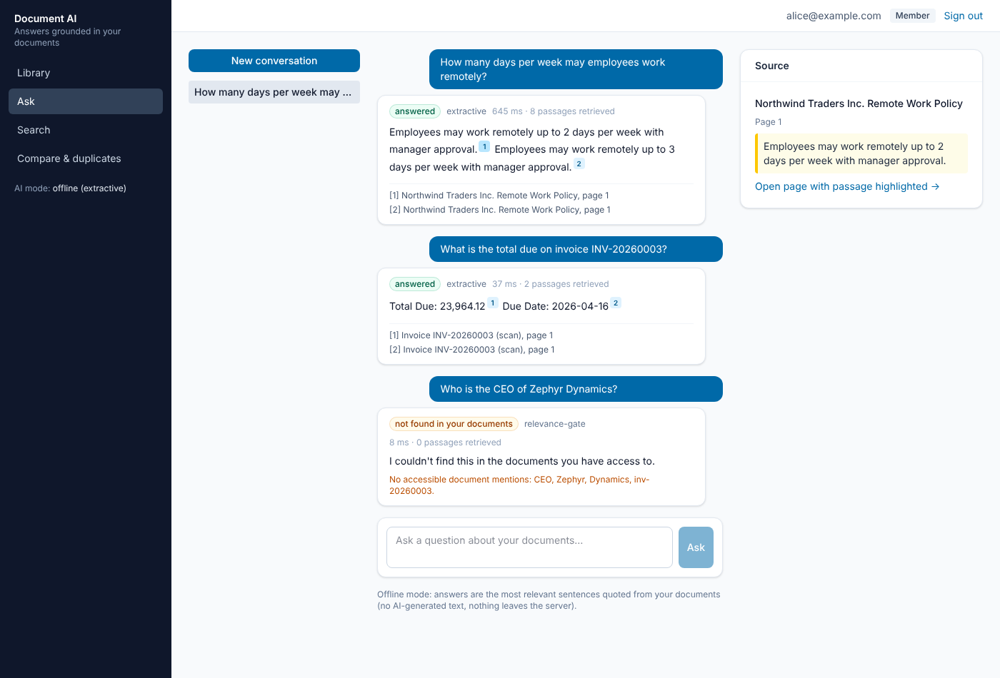
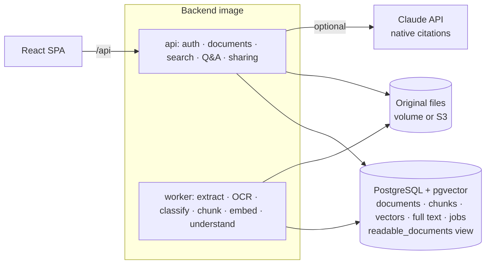

# Intelligent Document AI

Upload PDFs, Word files, text and scanned images. The platform reads them (OCR for scans), classifies them, extracts key fields, and answers questions **only from your documents, with citations to the exact page and passage**. When the documents don't contain the answer, it says so. One user's documents are never visible to another unless explicitly shared.

**Stack:** Python 3.13 · FastAPI · PostgreSQL 16 + pgvector · Tesseract OCR · local embeddings (bge-small, ONNX) · Claude API with native citations (optional) · React 18 + TypeScript · Docker · Terraform (AWS ECS + RDS + S3) · GitHub Actions



> **Data notice.** The demo library and evaluation use a seeded **synthetic** corpus (fictional companies and people). The numbers below describe that corpus, not real-world performance.

## What it does

| Area | Capabilities |
|---|---|
| **Ingestion** | PDF, DOCX, TXT, PNG/JPEG/TIFF. Type detected from file bytes, not the name. Size, page and zip-bomb limits. Background processing with per-stage status and retries |
| **Reading** | Text and tables per page; **Tesseract OCR** for scanned pages (94.7 % mean confidence on the demo scans); language detection (EN/FR/ES) |
| **Understanding** | Classification (invoice, contract, receipt, resume, report, letter, policy); summaries; entities (dates, amounts, e-mails, organisations); **invoice and contract field extraction with validation** (line items sum to subtotal, subtotal + tax = total, due date after issue date, missing fields) |
| **Search** | Hybrid keyword (PostgreSQL full text, EN/FR/ES stemming) + semantic (pgvector) with Reciprocal Rank Fusion |
| **Q&A** | Conversational, with follow-ups; every sentence cited; "not found" instead of guessing; **entity-constrained retrieval**; works offline (quotes source sentences) or with **Claude** (written answers via the API's native citations) |
| **Access control** | Owner + per-document read/edit shares, enforced **inside the retrieval SQL** through one view. Documents you can't read return 404 (existence not revealed); revoking a share also hides old citations |
| **More** | Versions with diffs, collections, document comparison (text + extracted fields), exact and near-duplicate detection (SHA-256 + MinHash), CSV export, admin stats/jobs |

Every AI-generated value is labelled with its provider and model; deterministic output is labelled "Rule-based".

## Architecture



The full design, alternatives and trade-offs are in [`docs/DESIGN.md`](docs/DESIGN.md). Section 10 lists what changed during implementation and why.

## Evaluation (actual results, [`ml/reports/evaluation.md`](ml/reports/evaluation.md))

136 synthetic documents (two users), 75 labelled questions. Retrieval and answers are measured **separately**. Mode: offline extractive (no API key).

| Measure | Result |
|---|---|
| Retrieval recall@5: keyword / vector / hybrid / **hybrid + entity filter** | 0.556 / 0.698 / 0.683 / **1.0** |
| Answer contains the correct value | **0.857** |
| At least one citation on the correct page | **0.968** |
| Correct "not found" on unanswerable and other-user questions | **1.0** (12 / 12) |
| Citations to another user's documents (leakage) | **0** |
| Classification accuracy / invoice and contract field accuracy | 1.0 / 1.0 (every field) |
| OCR character error rate (scans vs. digital originals) | 1.6 % |

Misses are concentrated where offline mode needs language understanding: English questions about French/Spanish letters (0 / 4), and "who issued…" phrasing on scanned invoices (0 / 4). With Claude configured, these are expected to improve; this has **not been measured**, because no API key was used during development. The evaluation report states which provider produced every number.

Two retrieval decisions came from these measurements:
- **Entity-constrained retrieval.** Plain hybrid search answered questions about invoice INV-99999 from *some other* invoice: grounded, but wrong. Requiring the documents to contain every code or name in the question fixed this, and raised refusal accuracy from 8 % to 100 %.
- **Exact vector search over the user's own chunks.** An approximate index filtered *after* the search can silently return nothing for users with few documents.

## Quick start (Docker)

```bash
cp .env.example .env
```

Edit `.env` and replace every `CHANGE_ME` value. Then:

```bash
docker compose up -d --build
```

```bash
docker compose run --rm api python -m app.cli demo
```

This loads 136 synthetic documents for `alice@example.com` and `bob@example.com`, plus an `admin@example.com`, all with the `DOCAI_DEMO_PASSWORD` from `.env`. Processing takes about 20 s. Open <http://localhost:8080>, then try **Ask** → "How many characters must a password contain?", or ask about an invoice number.

To enable Claude, set `ANTHROPIC_API_KEY` in `.env` (and optionally `DOCAI_CLAUDE_MODEL`, default `claude-opus-5-5`), then restart. Document passages are then sent to Anthropic's API, and the UI says so.

## Development and quality

| Check | Result (run locally at the latest commit) |
|---|---|
| Backend tests (pytest, PostgreSQL + pgvector, Tesseract) | 60 passed, 87 % line coverage, including an evaluation regression guard (leakage must stay 0) |
| Frontend tests (Vitest) | 8 passed |
| Browser smoke test vs. docker compose (`e2e/smoke.cjs`) | passed |
| ruff · mypy · ESLint · `tsc --strict` | clean |

See [`docs/DEVELOPMENT.md`](docs/DEVELOPMENT.md).

## Documentation

- [Design](docs/DESIGN.md) · [AI card](docs/AI_CARD.md) (how answers are produced and when not to trust them) · [Known limitations](docs/known-limitations.md)
- [Operations](docs/OPERATIONS.md) · [AWS deployment, cost and teardown](docs/AWS_DEPLOYMENT.md) · [API (OpenAPI)](docs/openapi.json)
- [Learning guide](docs/LEARNING_GUIDE.md): a walkthrough of the code with exercises
