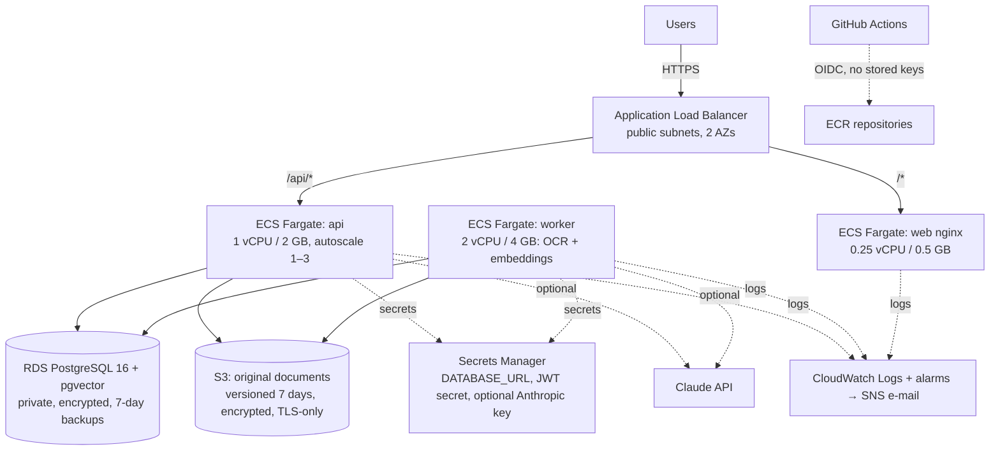

# AWS deployment

> **Status: designed, not deployed.** Nothing in this repository creates AWS resources automatically. The Terraform has **not** been applied, and was not validated locally (CI runs `fmt` and `validate`). Deploying requires a reviewed `terraform plan` and the budget alert below.

## Architecture



| Concern | Design |
|---|---|
| Network | VPC with 2 public subnets (ALB, NAT) and 2 private subnets (tasks, RDS); S3 gateway endpoint |
| Security groups | ALB: 80/443 from the internet. Tasks: only from the ALB. RDS: only from tasks |
| IAM | Execution role: pull images, write logs, read the app secrets. Task role: S3 access to the document-files bucket only. Deploy role: GitHub OIDC limited to this repo's `production` environment |
| Secrets | Generated by Terraform and stored in Secrets Manager, injected by ECS. They also exist in Terraform state, so **the state bucket must be encrypted and access-restricted** |
| Availability | ECS deployment circuit breaker with automatic rollback; API autoscaling on CPU. Single NAT and single-AZ RDS by default (cost); `single_nat_gateway=false` and `db_multi_az=true` for production |
| Monitoring | Alarms: API 5xx, unhealthy targets, p95 latency, RDS CPU and storage, job failures (log metric filter). Monthly budget alert |

## Cost estimate (us-east-1, on-demand, defaults)

These are approximate list prices; confirm with the [AWS Pricing Calculator](https://calculator.aws/) before deploying.

| Resource | Size | ≈ USD / month |
|---|---|---|
| NAT gateway | 1 × 730 h + light data | 33–40 |
| Application Load Balancer | 1, low traffic | 18–22 |
| RDS PostgreSQL | db.t4g.micro, 20 GB gp3, single-AZ, backups | 15–18 |
| Fargate: api | 1 vCPU / 2 GB × 730 h | ~36 |
| Fargate: worker | 2 vCPU / 4 GB × 730 h | ~72 |
| Fargate: web | 0.25 vCPU / 0.5 GB × 730 h | ~9 |
| CloudWatch logs, metrics, alarms | low volume | 5–10 |
| Secrets Manager, S3, ECR | 2 secrets, < 5 GB | 2–3 |
| Claude API (only if enabled) | ≈ $0.03 per question with `claude-opus-5-5` (≈ 6k input + 500 output tokens), plus about one call per uploaded document | usage-based |
| **Total (excluding Claude usage)** | | **≈ $195–215 / month** |

Ways to cut cost for a demo environment:
- **Scale to zero when idle:** `aws ecs update-service --desired-count 0` for all three services, plus `aws rds stop-db-instance` (RDS restarts automatically after 7 days). This saves the Fargate cost (~$117) and most of the RDS cost. The NAT gateway and ALB keep billing while they exist.
- **Short-lived demo:** `terraform apply`, record the demo, then `terraform destroy` the same day. That costs a few dollars.
- **Production hardening** (Multi-AZ RDS, 2 NAT gateways) adds roughly $50–60 per month.

## Deploy (first time)

Prerequisites: AWS CLI v2 logged in as an administrator (SSO recommended), Terraform ≥ 1.9, Docker.

1. Create the state bucket once, with versioning, encryption and public access blocked. Then:
   ```bash
   cd infra/terraform
   ```
   ```bash
   cp backend.hcl.example backend.hcl && cp terraform.tfvars.example terraform.tfvars
   ```
   Edit both files, then:
   ```bash
   terraform init -backend-config=backend.hcl
   ```
2. Create the registries first, so images can be pushed before the services start:
   ```bash
   terraform plan -target=module.app.aws_ecr_repository.api -target=module.app.aws_ecr_repository.web -out=ecr.plan
   ```
   ```bash
   terraform apply ecr.plan
   ```
3. Build and push the images. Use a git SHA tag; the tags are immutable.
   ```bash
   TAG=$(git rev-parse --short HEAD); API=$(terraform output -raw ecr_api_repository); WEB=$(terraform output -raw ecr_web_repository)
   ```
   ```bash
   aws ecr get-login-password | docker login --username AWS --password-stdin ${API%/*}
   ```
   ```bash
   docker build -t $API:$TAG ../../backend && docker push $API:$TAG && docker build -t $WEB:$TAG ../../frontend && docker push $WEB:$TAG
   ```
4. **Review the full plan.** It lists every resource that will be created.
   ```bash
   terraform plan -var image_tag=$TAG -out=full.plan
   ```
5. After reviewing the plan:
   ```bash
   terraform apply full.plan
   ```
6. Run the database migrations as a one-off task:
   ```bash
   eval "$(terraform output -raw migrate_command)"
   ```
7. Create the first admin with a one-off task, overriding the command to `python -m app.cli create-user --email ... --role admin` and passing `DOCAI_USER_PASSWORD` as an environment override.
8. *(Optional, Claude mode)* Deploy with `-var enable_claude=true`, then put the key **before** the services start, so it never appears in Terraform state:
   ```bash
   aws secretsmanager put-secret-value --secret-id docai/anthropic-api-key --secret-string 'sk-ant-...'
   ```
9. Open `terraform output app_url`.

## Update / rollback
- **Deploy a new version:** build and push a new `$TAG`, then `terraform apply -var image_tag=$TAG`. ECS performs a rolling deployment, and the circuit breaker rolls back automatically if new tasks fail their health checks.
- **Manual rollback:** `terraform apply -var image_tag=<previous tag>`. Images are kept; the last 20 are retained per repository.
- **Database migrations** must stay backwards-compatible with the previous app version (add columns, never rename them in one step), so that rolling back the app never requires rolling back the schema.
- **Turning Claude off** needs no deployment: remove the secret value or set `DOCAI_LLM_PROVIDER=extractive` in the task definition.

## Teardown
1. Take a manual RDS snapshot if you want to keep the data.
2. RDS has `deletion_protection = true`. Set it to `false` in `modules/data/main.tf`, then `terraform apply`.
3. Empty the document-files bucket, including object versions. It is versioned, so delete all versions in the console, or use `aws s3api delete-objects` with the output of `list-object-versions`.
4. Delete all images from the two ECR repositories (`aws ecr batch-delete-image`).
5. Destroy everything:
   ```bash
   terraform destroy
   ```
   RDS writes a final snapshot (`docai-db-final`). Delete it afterwards if you don't need it; it costs about $0.095 per GB-month.
6. Secrets Manager secrets enter a 7-day recovery window and are then deleted.
7. Check the Billing console the next day to confirm nothing remains: NAT gateways, EIPs, load balancers, snapshots.
