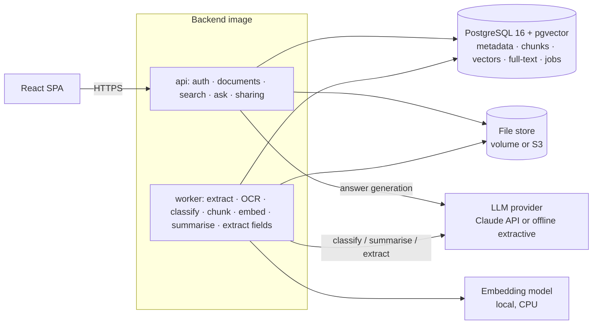
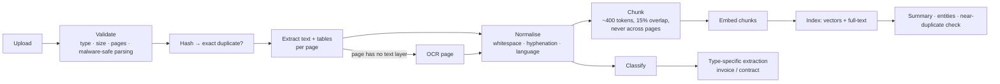
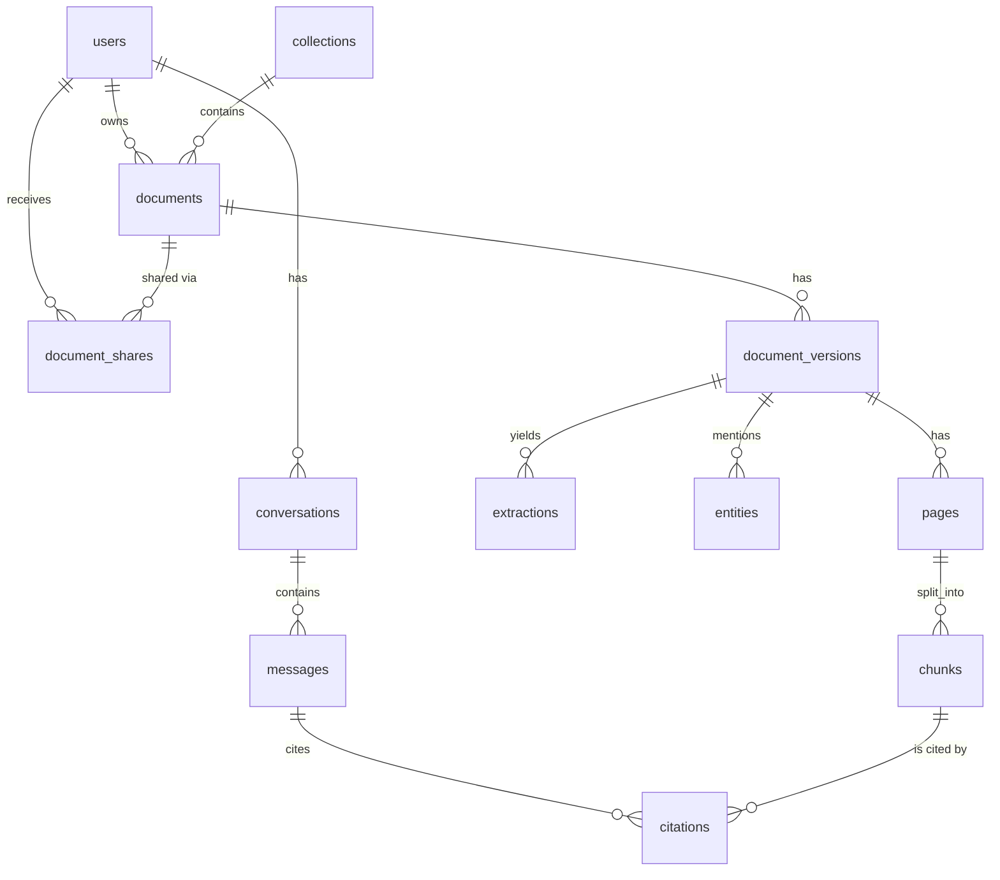

# Intelligent Document AI — Design Document (v1.0)

Status: **Approved by the owner ("build everything") with the recommended defaults in section 9, and implemented.** Section 10 lists the changes made during implementation.

Contents
1. Product requirements
2. Architecture
3. Document processing pipeline
4. Retrieval and question answering
5. Database design
6. API specification
7. Security and access control
8. Evaluation strategy and implementation roadmap
9. Decisions that need your approval

---

## 1. Product requirements

### 1.1 Problem
Organisations hold thousands of PDFs, scans and Word files. Finding a fact ("what is the termination notice period in our contract with Acme?", "which invoices from March are unpaid?") means opening files one by one. This platform ingests documents, understands their structure, and answers questions **only from the documents, with citations to the page and passage**. When the documents don't contain the answer, it says so.

### 1.2 Users and roles
| Role | Can do |
|---|---|
| **Admin** | Manage users, see system health and processing jobs, configure the AI provider |
| **Member** | Upload, organise, search and ask questions about their own documents and documents shared with them; share their documents |
| **Viewer** | Search and ask questions about documents shared with them; no uploads |

Document access is **per document** (owner + explicit shares), independent of role.

### 1.3 Functional requirements
| ID | Requirement |
|---|---|
| F1 | Upload PDF, DOCX, TXT, PNG, JPEG, TIFF (≤ 25 MB, ≤ 300 pages); validated by content (magic bytes), not by extension |
| F2 | Text extraction from digital PDFs and DOCX; **OCR** for scanned pages and images; tables extracted as structured rows |
| F3 | Metadata: title, page count, language, author/creation date where present, file hash |
| F4 | Automatic classification: invoice, contract, receipt, resume, report, letter, policy, other |
| F5 | Summaries per document |
| F6 | Embeddings for every chunk; hybrid (keyword + semantic) search with filters (type, date, collection, owner) |
| F7 | Conversational question answering (RAG) over one document, a collection, or everything the user can access |
| F8 | Every answer sentence linked to its source: document, page, passage. "Not found in your documents" when unsupported |
| F9 | Collections (folders/categories), user management, per-document sharing |
| F10 | Document comparison (two or more documents) and structured extraction |

### 1.4 Advanced requirements
A1 Invoice extraction (vendor, number, dates, totals, line items) · A2 Contract analysis (parties, term, renewal, termination, governing law, key clauses) · A3 Exact and near-duplicate detection · A4 Named entities: people, organisations, dates, amounts · A5 Document versions with diffs · A6 Multi-language processing · A7 Missing-information checks (e.g. an invoice without a due date) · A8 Structured reports (CSV/JSON export).

### 1.5 Non-functional requirements
- Answers must be grounded: no answer without at least one citation. This is enforced in code, not just in the prompt.
- One user's documents never appear in another user's search results, answers or citations. Tested explicitly.
- Processing is a modular pipeline with per-stage status, logging, retries and timeouts.
- Ask latency under 8 s p95 with a cloud LLM; search under 500 ms p95 at 10k documents (to be measured, not assumed).
- Runs fully offline in "extractive mode" (no API key) for development, CI and demos.

### 1.6 Out of scope
Handwriting recognition, e-signature, real-time collaborative editing, connectors to Google Drive or SharePoint, and real customer data (all demo data is synthetic).

---

## 2. Architecture

Same proven shape as Project 1: **one FastAPI codebase, run as an API process and a worker process**, with PostgreSQL as both the database and the job queue. pgvector adds vector search, so there is still only one data store.



| Option | Pros | Cons |
|---|---|---|
| **PostgreSQL + pgvector (recommended)** | One database; access-control filters and vector search run in **one SQL query**, so permissions can't be bypassed by a separate vector store; transactional; available on AWS RDS | Slower than dedicated engines past tens of millions of vectors |
| Dedicated vector DB (Qdrant, Pinecone, OpenSearch) | Scale, built-in hybrid search | Second system to secure and keep in sync; permissions must be duplicated into vector metadata (a classic leak source) |

### Provider interfaces (swappable by configuration)
```
LLMProvider:        answer(question, passages) -> answer + citations
                    classify(text) · summarise(text) · extract(text, schema)
EmbeddingProvider:  embed(texts) -> vectors
OCRProvider:        ocr(image) -> text + word boxes
```
- **LLM:** `ClaudeProvider` (Anthropic SDK) or `ExtractiveProvider`. The extractive provider needs no network: it returns the best-matching passages with their citations instead of a generated answer, and rule-based fallbacks for classification and summaries.
- **Embeddings:** local `BAAI/bge-small-en-v1.5` through `fastembed` (ONNX, CPU, 384 dimensions, free, no PyTorch). `multilingual-e5-small` for multi-language collections. Anthropic does not offer an embeddings API, so a separate provider is required either way.
- **OCR:** Tesseract (open source, with language packs).

---

## 3. Document processing pipeline

Every upload creates a `document_version` and a chain of jobs. Each stage is **idempotent** (safe to retry), records its status and timings, and has a timeout. A failed stage retries with backoff; after the last retry the document is marked `failed` with the reason shown in the UI.



Design notes:
- **Chunks never cross page boundaries**, so every citation maps to exactly one page. Each chunk stores its page number and character offsets in the page text.
- **Tables** are extracted (pdfplumber for PDF, python-docx for DOCX) and stored as structured rows *and* as a Markdown rendering inside the chunk, so they are both searchable and displayable.
- **Near-duplicates:** MinHash over word shingles (Jaccard ≥ 0.9) flags likely duplicates. This is cheap, explainable, and independent of the embedding model.
- **Parsing untrusted files** happens only in the worker, under per-file time and memory limits. A malformed PDF can crash its own job but not the API.

---

## 4. Retrieval and question answering

### 4.1 Hybrid retrieval
1. **Access filter first:** the candidate set is limited to document IDs the user may read, as a `JOIN` inside the same SQL statement as the search.
2. **Keyword search:** PostgreSQL full-text search (`tsvector`, BM25-like `ts_rank_cd`). This catches exact terms such as invoice numbers and names.
3. **Semantic search:** pgvector cosine similarity (HNSW index) on chunk embeddings. This catches paraphrases.
4. **Fusion:** Reciprocal Rank Fusion of the two result lists, then the top 8 passages go to answering.

### 4.2 Answer generation with citations
- Retrieved passages are sent to Claude as separate `document` content blocks with **native citations enabled**. Each response sentence comes back with `cited_text` and the block index, which maps to our chunk, and therefore to its document, page and offsets.
- **Grounding rules, enforced in code:**
  - If the best retrieval score is below a calibrated threshold, the platform answers "I couldn't find this in your documents" **without calling the LLM**.
  - The system prompt instructs the model to answer only from the provided passages, to say when they don't contain the answer, and to treat document text as data, never as instructions.
  - After generation, any sentence without a citation is shown as *"not supported by a source"*. An answer with zero citations is replaced by the not-found message.
- **Conversation:** follow-up questions are rewritten into standalone questions before retrieval, so that "and when does it expire?" still retrieves the right contract.
- The UI shows the answer, numbered citation chips, and a side panel with the cited passage highlighted on its page.

### 4.3 AI-generated vs deterministic output
Every API field and UI element states its source. *Extracted* (parsers, OCR, regex validation) is deterministic. *Generated* (summaries, answers, LLM extraction) carries the provider and model name. Invoice totals extracted by the LLM are cross-checked (line items sum to the total, dates parse) and flagged when they fail.

---

## 5. Database design



| Table | Key columns | Notes |
|---|---|---|
| `users`, `refresh_tokens`, `audit_log`, `jobs` | as Project 1 | Proven auth and queue code reused |
| `collections` | id, owner_id, name | Folders/categories |
| `documents` | id, owner_id, collection_id, title, doc_type, doc_type_source (`model`/`rule`/`user`), current_version_id, created_at | Logical document |
| `document_shares` | document_id, user_id, permission (`read`/`edit`) | PK (document_id, user_id) |
| `document_versions` | id, document_id, version_no, file_key, sha256, mime, size, page_count, language, status, error, processed_at | `UNIQUE(document_id, version_no)`; sha256 indexed for exact duplicates |
| `pages` | version_id, page_no, text, ocr_used, ocr_confidence | |
| `chunks` | id, version_id, page_no, char_start, char_end, text, `tsv tsvector`, `embedding vector(384)`, token_count | GIN index on `tsv`, HNSW index on `embedding` |
| `extractions` | version_id, kind (`invoice`/`contract`/`summary`), data JSONB, source (`model:<id>`/`rule`), validation JSONB | |
| `entities` | version_id, type, value, normalised, page_no | |
| `minhash_signatures` | version_id, signature bytea | Near-duplicate search |
| `conversations`, `messages` | message: role, content, provider, model, token usage, latency_ms | Search and conversation history |
| `citations` | message_id, chunk_id, cited_text, ordinal | Join to chunk → page → document |

---

## 6. API specification (v1, abridged)

| Method & path | Purpose |
|---|---|
| `POST /auth/login` · `/refresh` · `/logout` · `GET /auth/me` | As Project 1 |
| `POST /documents` (multipart) | Upload → 202 with document and processing status |
| `GET /documents?q=&type=&collection=&from=&to=` | List/filter documents the caller can read |
| `GET /documents/{id}` · `DELETE /documents/{id}` | Detail incl. processing stages; delete (owner only) |
| `POST /documents/{id}/versions` | Upload a new version |
| `GET /documents/{id}/versions/{v}/pages/{n}` | Page text + highlight offsets (for citation view) |
| `GET /documents/{id}/file` | Download the original (permission-checked, streamed) |
| `PUT /documents/{id}/shares` | Share with users (owner only) |
| `GET /documents/{id}/extraction` | Invoice/contract fields with validation results |
| `POST /search` | Hybrid search: passages with scores and locations |
| `POST /conversations` · `POST /conversations/{id}/messages` | Ask (streamed via Server-Sent Events) → answer + citations |
| `POST /compare` | Compare 2–5 documents (text diff + generated comparison with citations) |
| `GET /duplicates` | Exact and near-duplicate groups |
| `GET /reports/extractions.csv?type=invoice` | Structured export |
| `GET /admin/jobs` · `GET /health/ready` | Operations |

---

## 7. Security and access control
- **Authorisation in the query:** every search, retrieval and citation lookup joins through a single SQL view `readable_documents(user_id, document_id)`. Tests create two users with similar documents and assert that no endpoint ever returns the other user's content, including through citations, duplicates, comparisons and exports.
- **Uploads:** content-type sniffing (magic bytes), size and page limits, DOCX zip-bomb protection (uncompressed-size cap), server-generated storage keys, original filenames never used as paths, and files never served inline (`Content-Disposition: attachment`, `X-Content-Type-Options: nosniff`).
- **Prompt injection:** documents may contain text like "ignore previous instructions". The model has **no tools and no actions**, so the worst case is a misleading answer, never an action. Document text is passed only inside document blocks; the system prompt tells the model to treat it as data. Answers render as plain text (no HTML), which avoids XSS. A test corpus includes injection attempts.
- **Secrets:** the LLM API key comes from an environment variable or AWS Secrets Manager, never from the database or the repository.
- **Privacy:** documents are sent to the LLM provider only when cloud mode is on; the admin UI says so. Extractive mode keeps everything local.

---

## 8. Evaluation strategy and implementation roadmap

### 8.1 Evaluation (no fabricated numbers)
- **Synthetic corpus** (generated, reproducible, seed-controlled): about 150 documents. Invoices with known totals and line items, contracts with known clauses, policies, letters, resumes, and scanned (image-rendered) copies of some of them, plus near-duplicates and a few French and Spanish documents.
- **Labelled question set:** about 120 questions, each with a gold answer and gold passages. 20% are deliberately unanswerable, and some target documents owned by another user.
- **Measured separately:**
  - **Retrieval:** recall@5, MRR. Compared across keyword-only, vector-only and hybrid.
  - **Answers:** exact or numeric match on factual questions, citation precision (do the cited passages contain the answer?), refusal accuracy on unanswerable questions, and leakage (must be 0).
  - **Extraction:** field-level precision/recall on invoices and contracts. **Classification:** accuracy and confusion matrix. **OCR:** character error rate on rendered scans.
- LLM-dependent metrics run only with an API key, and the report states provider, model, date and cost. CI runs the offline metrics on every push.

### 8.2 Roadmap
| # | Milestone | Deliverables |
|---|---|---|
| M0 | Foundation | Repo, Docker Compose (Postgres + pgvector, api, worker, web), CI, auth and job queue ported from Project 1 |
| M1 | Documents & storage | Upload validation, versions, collections, sharing, `readable_documents`, leakage tests |
| M2 | Extraction pipeline | PDF/DOCX/TXT text and tables, OCR, language detection, per-stage status/retries |
| M3 | Synthetic corpus | Generator for documents + labelled question set |
| M4 | Indexing & search | Chunking, embeddings, full-text, hybrid search, retrieval evaluation |
| M5 | Q&A with citations | Provider interface, Claude provider with native citations, extractive provider, grounding rules, conversations (SSE) |
| M6 | Understanding | Classification, summaries, entities, invoice/contract extraction with validation |
| M7 | Advanced | Duplicates, comparison, version diffs, multi-language, reports |
| M8 | Frontend | Library, upload, document viewer with citation highlighting, chat, search, sharing, admin |
| M9 | Hardening & AWS | End-to-end tests, injection tests, load check, Terraform design (not applied), docs, learning guide |

---

## 9. Decisions that need your approval

1. **AI model for answers, summaries and extraction.** These are approximate per-question costs, assuming about 6,000 tokens of passages in and 500 tokens out:

   | Option | Quality | ≈ cost per question |
   |---|---|---|
   | **Claude Opus 5.5** (Anthropic's recommended default) | Highest | ≈ $0.034 |
   | Claude Sonnet 5.5 | High | ≈ $0.017 |
   | Claude Haiku 5.5 | Good for extraction and classification | ≈ $0.001 |
   | Extractive mode only (no API key) | Returns cited passages, no written answer | $0 |

   **Recommendation:** build both providers. Use extractive mode for CI and offline demos, and Claude when an `ANTHROPIC_API_KEY` is configured. The model is a setting, so you can change it any time. **I need to know:** will you provide an Anthropic API key (now or later), and which model do you want as the default?
2. **PostgreSQL + pgvector** instead of a separate vector database (§2).
3. **Local embeddings** (`bge-small-en-v1.5` via fastembed: free, CPU, offline).
4. **Tesseract OCR** (free, local) instead of a cloud OCR service such as AWS Textract (better on poor scans, about $1.50 per 1,000 pages).
5. **Reuse Project 1's auth, job queue and app structure** by copying them into this repo, so each project stands alone for recruiters, rather than as a shared package.
6. **Frontend stack** identical to Project 1 (Vite + React + TypeScript + Tailwind + TanStack Query).

---

## 10. Changes made during implementation

| Area | Design | Built | Why |
|---|---|---|---|
| AI model | Owner to choose | Provider-neutral: Claude (`claude-opus-5-5`, configurable) when `ANTHROPIC_API_KEY` is set, otherwise offline extractive | Owner approved the recommended defaults; no key was available during development, so every reported number is from offline mode |
| Retrieval | Hybrid search, then the LLM | Hybrid search **plus an entity filter**: codes and names in the question must appear in the document | The first evaluation answered "INV-99999?" from *another* invoice: grounded, but wrong. Refusal accuracy went from 0.083 to 1.0 and answer correctness from 0.016 to 0.857 (together with the two fixes below) |
| Sentence splitting | Regex on `.!?` | Split only before whitespace and a capital letter, or at newlines | The original split "1,234.56" in two, losing every amount |
| Keyword query | Sanitised terms | Hyphenated codes split into parts (`INV-20260003` → `inv \| 20260003`) | Matches how PostgreSQL indexes them; invoice numbers previously never matched |
| Vector search | HNSW index scan | Exact scan over the user's allowed chunks | Approximate scans filter after the search and can silently return nothing under access control |
| Answer streaming | Server-Sent Events | Single JSON response | Offline answers take about 50 ms; streaming is listed in known limitations |
| Worker threads | Library defaults | `DOCAI_EMBEDDING_THREADS=2`, `OMP_THREAD_LIMIT=1` in the image | Measured 11 min → 19 s for the demo library in docker compose |
| Evaluation labels | Generated questions | Policy questions rewritten to be specific ("How many days per week may employees work remotely?"); scans accepted as equivalent to their originals | The original wording ("what is the key limit?") was ambiguous; citing the scan of the same invoice is correct |
| S3 versioning | 90-day retention of old versions | 7 days | Deleted documents shouldn't linger |
